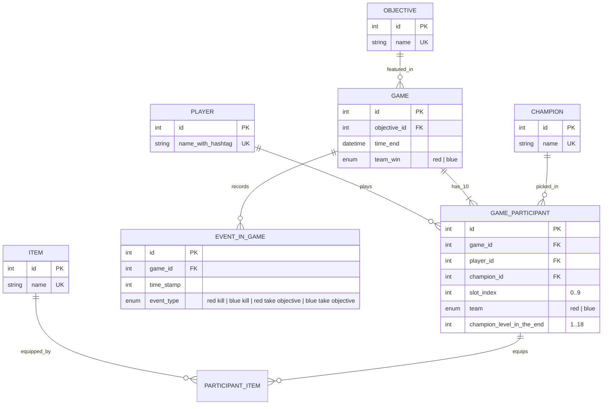

# Database & Domain Specification

## 1. Entity Relationship Overview

To avoid N+1 queries and support fast pagination/filtering (including the planned `/players_games_info?player_id=&game_id=`), the 10-player arrays in `game` and 20-game history in `player` are stored as normalized relational tables and exposed in JSON as the expected arrays (`players_id[10]`, `champion_id[10]`, `champion_level_in_the_end[10]`, `recent_games_id[20]`).

## 2. Tables & Indexes

| Table | Key Columns & Constraints | Indexes |
| :--- | :--- | :--- |
| `players` | `id` PK, `name_with_hashtag` (`VARCHAR(64)`, unique, not null) | `idx_players_name` |
| `games` | `id` PK, `objective_id` FK -> `objectives.id`, `time_end` (`DATETIME`), `team_win` (`ENUM('red','blue')`) | `idx_games_time_end` |
| `game_participants` | `id` PK, `game_id` FK, `player_id` FK, `champion_id` FK, `slot_index` (`0..9`), `champion_level_in_the_end` (`1..18`) | `uq_game_slot (game_id, slot_index)`, `idx_gp_player_game (player_id, game_id DESC)` |
| `events_in_game` | `id` PK, `game_id` FK -> `games.id` (`ON DELETE CASCADE`), `time_stamp` (`INT >= 0`), `event_type` (`ENUM`) | `idx_events_game_ts (game_id, time_stamp)` |
| `champions` | `id` PK, `name` (`VARCHAR(64)`, unique, not null) | — |
| `items` | `id` PK, `name` (`VARCHAR(64)`, unique, not null) | — |
| `objectives` | `id` PK, `name` (`VARCHAR(64)`, unique, not null) | — |

## 3. Endpoint Projection & Query Strategy

| Endpoint | Returned Fields | Query / N+1 Prevention Strategy |
| :--- | :--- | :--- |
| `GET /players` | `id`, `name_with_hashtag` | Single paginated `SELECT id, name_with_hashtag` query; no joins. |
| `GET /players/<id>` | `id`, `name_with_hashtag`, `recent_games_id[20]` | `selectinload` or bounded subquery `LIMIT 20 ORDER BY game_id DESC` on `game_participants`. |
| `GET /games` | `id`, `players_id`, `champion_id`, `team_win`, `time_end` | Paginated `games` query + `selectinload(Game.participants)` (constant 2 queries regardless of `per_page`). |
| `GET /games/<id>` | All `game` fields + `events` (`event_in_game`) | `selectinload(Game.participants)` + `selectinload(Game.events)` (bounded 3 queries). |
| `GET /champions`, `/items`, `/objectives` | `id`, `name` | Single paginated `SELECT` query. |
| `GET /players_games_info?player_id=&game_id=` | Planned | Filtered query on `game_participants` using `idx_gp_player_game`. |

## 4. Planned Schema Extensions

- **`event_in_game` future columns**: `killer_player_id` (nullable FK -> `players.id`), `victim_player_id` (nullable FK -> `players.id`), `objective_team` (nullable `ENUM('red','blue')`).
- **`participant_items`**: Join table linking `game_participants.id` and `items.id` for `/players_games_info`.

